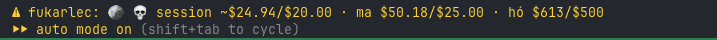
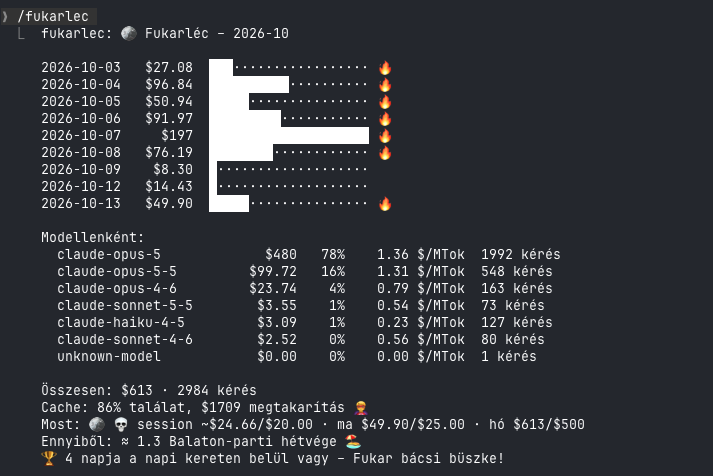
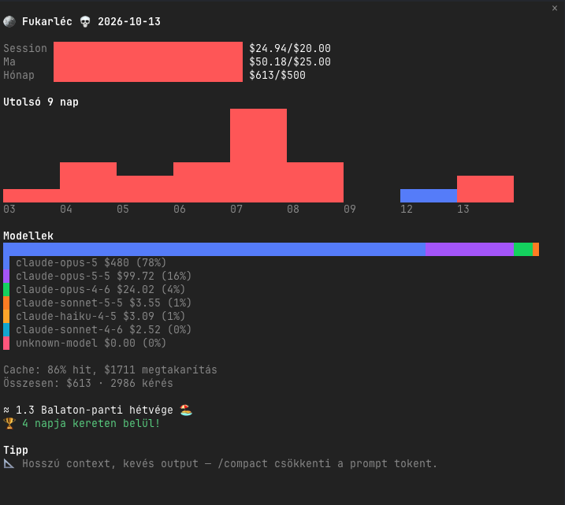

# 🪙 fukarléc

> **A Fukarléc beköltözött a Frugalitasba.** Mostantól a [Frugalitas](https://github.com/siposzoltan03/frugalitas) egyik
> módja: `/plugin install frugalitas --marketplace siposzoltan03/frugalitas`, majd `/plugin uninstall fukarlec`.
> A 0.2.0 kiadás átadja a garasaidat (`~/.claude/fukarlec-ledger.json`), a Frugalitas pedig Fukarléc módban indul.
> Váltás: `/frugal mode fukarlec` vagy `/frugal mode frugalitas`.

Claude Code plugin, ami a LiteLLM proxy saját költségkönyveléséből figyeli, mennyibe kerülsz.
Csak LiteLLM-en futó sessionben aktív (`ANTHROPIC_BASE_URL` + `ANTHROPIC_AUTH_TOKEN`, opcionálisan `ANTHROPIC_CUSTOM_HEADERS`),
máshol némán nem csinál semmit.

## Mit tud

### Status line


Session/napi/havi költés, 5 percenként és minden kör után frissül.
A session költése a session saját köreinek (subagentekkel együtt) tokenjei, a proxy `/model/info` áraival beárazva, így más
sessionök vagy az opencode ugyanazon a kulcson nem keverednek bele. A napi és havi érték a LiteLLM valódi, számlázott összege.
Ha a kulcs a session alatt jóval többet költ, mint maga a session, a riport és a `/fukarlec tips` jelzi, hogy valószínűleg
párhuzamos használat van.

### `/fukarlec` riport


Havi riport napi oszlopokkal, modellenkénti bontással ($/MTok), cache-találati aránnyal és -megtakarítással.
`/fukarlec 7`: utolsó 7 nap · `/fukarlec refresh` · `/fukarlec help`

### Dashboard panel


`/fukarlec panel` — élő sidebar dashboard:
- Budget gauge-ok (session/napi/havi), színváltás ahogy közelít a limithez
- Napi sparkline az utolsó napok költéséről
- Modell-megoszlás színes sávval és legenddel
- Cache statisztika és élő cache-visszaszámláló
- Spórolási tippek a valós számokból
- Vicces mód: lángos-átváltás, streak, hangulat-emoji

### Budget-őr
80%-nál és 100%-nál toast (100%-nál natív értesítés is). `block` módban keret felett nem enged új promptot,
amíg `/fukarlec allow` fel nem oldja aznapra.

### Cache-visszaszámláló
A prompt cache 5 percig meleg (egy óráig, ha `promptCacheTtl: "1h"` vagy `CLAUDE_CODE_PROMPT_CACHE_TTL=1h` van beállítva),
a kör utolsó modellkérésének kezdetétől számítva, nem a kör végétől: minden kérés az indulásakor indítja újra a cache
élettartamát, így egy hosszú záró válasz ebből fogy. A visszaszámlálás is innen indul. Utána a következő kör a teljes
contextet újraírja, cache-írási áron.
Ha a záró válasz maga tovább tartott a cache élettartamánál, a kör már lejárt cache-sel ér véget, és a status line meg a
folytatás/compact/clear tanács ezt azonnal jelzi.

- **Status line:** `… · ⏳ cache 3:42`, az utolsó percben `⌛ cache 0:42!`, utána `❄️ cache lejárt`. Kör közben nem számol,
  mert a cache akkor frissül.
- **Panel – modell és context:** a session modellje a millió tokenenkénti áraival, és hogy mennyire telt meg a
  context ablak (`Context: 182k / 1M ▰▰▱▱▱▱▱▱▱▱ 18%`, 80%-tól pirosan), azzal együtt, hogy minden kör legalább mennyiért
  olvassa.
- **Panel:** a „Cache: X% hit” sor alatt `⏳ Cache: 3:42 ▰▰▰▰▰▰▰▱▱▱`, az utolsó percben pirosan.
- **~30 mp-cel lejárat előtt** (50k token feletti contextnél): toast az újraírás árával, és azzal, mennyibe kerülne most
  a `/compact`, amíg a cache meleg. Ha az újraírás legalább $0.50, natív értesítés is jön.
- **Lejáratkor:** a következő 10 kör ára háromféleképp (folytatás, `/compact`, `/clear`) a proxy valós áraiból, ajánlással:
  ugyanazon a feladaton folytasd vagy compactolj, új feladatnál `/clear`. Amíg a cache lejárt, ez a panelen és a
  `/fukarlec tips`-ben is látszik.
- `/reload-plugins` után is tovább számol: az utolsó kör ideje sessionönként megmarad.

### Újrakezdés átadásból
Ha a cache már lejárt, egy nagy beszélgetés folytatása a fő modelleden az egészet újraírja, és a `/compact` is. A
`/fukarlec restart` ugyanezt egy kis modellel végzi:

1. beolvassa a beszélgetést: minden elhangzott szót megtart, a hosszú tool-kimeneteknek csak az elejét és a végét;
2. a proxy legolcsóbb Haikuja (ha abba nem fér bele, Sonnetje) átadást ír: cél, jelenlegi állapot, döntések, zsákutcák,
   nyitott kérdések, következő lépések, fájlok;
3. lefuttatja a `/clear`-t, és az átadásból folytatja, immár kicsi beszélgetésben.

A `/fukarlec restart sonnet` Sonnetet használ, ha a session sok kényes döntést tartalmazott.

Minden átadás Markdownként is elmentődik: `~/.claude/handovers/<id>.md` (időpont, modell, projektmappa és a szöveg),
így semmi nem vész el, ha az újrakezdés félúton megáll, és később is folytatható:

- `/fukarlec handovers` listázza a legutóbbiakat, a `/fukarlec handovers <id>` megnyit egyet;
- `/fukarlec resume <id>` az aktuális sessionben folytat belőle, például másnap egy új sessionben.

Amíg a teambrain nem elérhető, ezek a helyi fájlok az átadások otthona; ha elérhető lesz, oda is mehetnek.

A parancsok angolul vannak (`refresh`, `allow`, `tips`, `restart`, `handovers`, `resume`, `shop`, `buy`); a korábbi
magyar nevek (`frissít`, `engedd`, `tippek`, `újrakezd`, `bolt`, `vesz`) továbbra is működnek.

Csak javasolja, magától sosem csinálja: ha a cache lejárt, a context legalább 50k token, és az újrakezdés a következő 10
körre egyértelműen olcsóbb a folytatásnál és a `/compact`-nál is. Ilyenkor a folytatás/compact/újrakezdés/clear
összevetés és a küldés előtti figyelmeztetés az árával együtt felajánlja. Új feladatnál továbbra is a `/clear` a
legolcsóbb.

### Session-költés
A session-érték a session saját köreiből számolódik, nem a kulcs teljes költéséből:

- **Mit számol:** minden kör (a fő szál és a subagentek) tokenjeit: input, output, cache-olvasás és cache-írás, a proxy
  `/model/info` áraival. Opus 5.5-nél például $4 / $20 / $0.20 / $5 per millió token.
- **1 órás cache** (`promptCacheTtl: "1h"`): a cache-írás drágább, 2× input az 5 perces cache 1,25×-e helyett. Ezt is így számolja.
- **Mikor frissül:** minden kör végén azonnal; nem kell megvárni a LiteLLM kötegelt könyvelését.
- **Megmarad:** sessionönként elmentődik, így `/reload-plugins` után sem nullázódik.
- **Ha az árak még nincsenek meg:** a kör költése sorba áll, és amint az árak betöltődtek, beszámolódik.
- **Drága kör:** ha egy kör (a közben futó subagentekkel együtt) eléri az `expensiveTurn` küszöböt, a kör végén azonnal szól.
- **Párhuzamos használat:** a kulcs költésének változását a session alatt ellenőrzésnek megtartja. Ha legalább $1, és több,
  mint a session saját költésének 1,3-szorosa + $0.50, a riport és a `/fukarlec tips` jelzi, hogy valószínűleg más session
  vagy az opencode is használja a kulcsot.
- **Ami nincs benne:** a köreken kívüli apró háttérhívások (például a session-cím generálása). A session-érték ezért kicsit
  alulbecsülhet; a mérvadó, számlázott összeg a napi és havi érték, ami a LiteLLM-ből jön.

### Spórolási tippek
Max. 30 percenként egy, a valós mai számokból: Opus-túlsúly, alacsony cache-találat, újraírt cache modellváltás vagy hosszú szünet után.

### Vicces mód
Hangulat-emoji (😇 → 🙂 → 😬 → 🥵 → 🔥 → 💀), Fukar bácsi beszólásai, forintosítás lángosban, sörben, BKK-bérletben
és Balaton-parti hétvégében, 🏆 „fukar sorozat" a napi kereten belül maradt napokra.

A napok UTC szerint értendők, ahogy a LiteLLM számol.

## Spórolási tippek

A tippek toastként jönnek (a sima tippek legfeljebb 30 percenként egy, a sürgősek azonnal, de mindegyik csak egyszer),
a panel Tipp blokkjában, és mind egyben: `/fukarlec tips`. A felvett üzenet-pack hangján szólnak.

- **Session közben:** ⏳ lejárt cache (5+ perc szünet után a következő kör újraírja a contextet – még küldés előtt szól,
  becsült összeggel), 🐘 hízó context, 📦 óriási Bash/Read kimenet, 🔁 ugyanaz a fájl sokszor beolvasva,
  🤖 subagent-túlsúly, ✂️ mennyit spórolt a /compact.
- **A LiteLLM számaiból:** 📈 hó végi előrejelzés a havi kerethez, ✍️ drága output-arány, ⚠️ hibás kérések,
  📅 a hét legdrágább napja, 🧠 Opus-túlsúly, 🧊 alacsony cache hit. Az árakat a proxy `/model/info`-ja adja.
- **🎯 Napi küldetés:** pl. „maradj 50% Opus alatt”; ha a lezárt nap kereten belül volt és teljesült, +5 garas.

## Garas, rangok, bolt

Minden lezárt (UTC) nap, amikor dolgoztál, de a napi keret alatt maradtál, **garast** (XP) hoz:
10 alap + max. 10 a megspórolt hányadért + sorozat-bónusz (napi +2, max. +10). Az üres napok nem adnak garast,
de a sorozatot sem törik meg; a keret feletti nap 0 és megszakítja. A jóváírt nap rögzül, a keret utólagos
emelése nem fizet újra.

Rangok: 🧺 Napszámos → 🌱 Zsellér (50) → 🐂 Béres (150) → 🌾 Gazda (350) → 🏡 Nagygazda (700) → 🏰 Fukar földesúr (1200).

A garast Fukar bácsi boltjában költöd el:

| Skin | Ár | | Üzenet-pack | Ár |
|---|---|---|---|---|
| Paraszt bácsi | ingyen | | Fukar bácsi | ingyen |
| Csikós | 150 | | Nagymama | 60 |
| Kofa néni | 150 | | Kocsmai | 60 |
| Juhász | 200 | | Betyár | 90 |
| Matyó legény | 300 | | NAV-ellenőr | 120 |

`/fukarlec xp` · `/fukarlec shop` · `/fukarlec buy <id>` (vásárlás, utána fel is veszi) ·
`/fukarlec skin <id>` / `/fukarlec pack <id>` (megvett tétel felvétele, sosem vásárol)

## Telepítés

```
/plugin install fukarlec --marketplace siposzoltan03/fukarlec
```

Lokális fejlesztéshez (ha klónoztad a repót):

```
/plugin marketplace add ~/projects/fukarlec
/plugin install fukarlec@fukarlec
```

Lokális marketplace esetén a szerkesztések után elég egy `/reload-plugins`.

## Beállítás

`/config` → fukarlec: session-, napi- és havi keret (USD, 0 = nincs), `warn`/`block` mód, „drága kör" küszöb, vicces mód, USD/HUF árfolyam.

## Fejlesztés

```
claude plugin validate .
claude plugin test .
claude -p "/fukarlec" --plugin-dir .   # LiteLLM env változókkal
```
